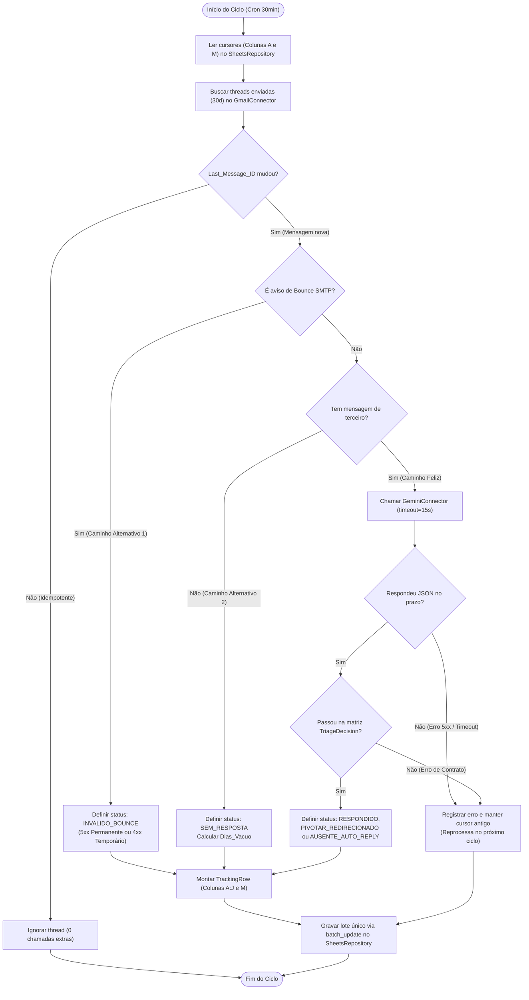

# [RFC-0001] Motor de Triagem e Rastreamento de E-mails Outbound

| Metadados | Detalhes |
| :--- | :--- |
| **Status** | Em Proposta / Implementação |
| **Data** | 2026-11-07 |
| **Serviços Externos (Connectors)** | Gmail REST API, Google Gemini API |
| **Armazenamento (Repository)** | Google Sheets API v4 (aba `Rastreamento`) |

---

## Contexto e a Parte Difícil

Equipes operacionais que disparam dezenas ou centenas de e-mails ativos (*outbound*) — processos seletivos, captação de patrocínios, convites de bancas e cobranças operacionais — perdem o controle do acompanhamento logo após o envio.

A parte que resiste à automação simples tem três pontos:
1. **Mistura entre protocolo e linguagem natural:** Parte dos retornos são erros padronizados de servidor (`mailer-daemon` / SMTP `5xx` e `4xx`) ou ausência total de resposta; outra parte são respostas humanas ou avisos de férias (*Out of Office*) indicando outro colega no meio de um parágrafo em texto livre.
2. **Custo e cota de API externa:** Chamar um modelo de linguagem (LLM) para ler todas as conversas enviadas nos últimos 30 dias a cada execução estoura a cota gratuita da API e reprocessa conversas que não mudaram.
3. **Concorrência entre robô e humano na mesma tabela:** A equipe trabalha diretamente na planilha atribuindo responsáveis (`Coluna K`) e escrevendo notas (`Coluna L`). Se a automação reescrever a linha inteira ao atualizar o status de um e-mail, ela apaga o trabalho manual da equipe.

Esta RFC propõe a modelagem de dados, os contratos de entrada/saída, os fluxos de execução (feliz, alternativo e de erro) e os *trade-offs* arquiteturais do serviço.

---

## 01. Armazenamento e Entidades (O Banco / Estado)

Seguindo a regra de desenhar o armazenamento antes dos fluxos, o estado do sistema vive na aba **`Rastreamento`** do Google Sheets e é espelhado no código pelas entidades em `src/domain/entities.py` e pelos enumeradores em `src/domain/enums.py`.

### 1.1. As Camadas do Serviço (Padrão Base-Service)

| Camada | Arquivo / Pacote | Pergunta que Responde | O que NÃO Faz |
| :--- | :--- | :--- | :--- |
| **`domain/`** | `src/domain/entities.py`<br>`src/domain/enums.py`<br>`src/domain/protocol_inspector.py` | Quais entidades e estados existem? O que o protocolo RFC 5322 já resolve dentro de casa? | Chamar rede, ler variável de ambiente ou falar com a planilha. |
| **`controllers/`** | `src/controllers/triage_controller.py` | Pode ou não pode? A thread mudou? Resolve por regra de protocolo ou liga para o Gemini? | Montar requisição HTTP bruta ou escrever intervalo da planilha. |
| **`connectors/`** | `src/connectors/gemini_connector.py`<br>`src/connectors/gmail_connector.py` | Como falo com um serviço de fora (com `TIMEOUT` obrigatório) e desembrulho a resposta? | Decidir regra de negócio (`if` de status) ou tocar na planilha. |
| **`repositories/`** | `src/repositories/sheets_repository.py` | Como busco os cursores salvos e gravo o lote de linhas na planilha? | Decidir qual é o status do e-mail ou chamar o Gemini. |

### 1.2. A Tabela na Planilha (`TrackingRow`) e Suas Chaves

Cada linha na aba `Rastreamento` representa uma única conversa iniciada pela nossa conta (`EmailThread`).

| Col | Campo | Tipo | Papel na Modelagem |
| :-: | :--- | :--- | :--- |
| **A** | `Thread_ID` | `STRING (PK)` | **Chave primária da conversa.** Identificador hexadecimal único gerado pelo Gmail. |
| **B** | `Destinatario` | `STRING (NOT NULL)` | E-mail normalizado para quem nossa equipe enviou a primeira mensagem. |
| **C** | `Assunto` | `STRING (NOT NULL)` | Assunto original da conversa. |
| **D** | `Data_Envio` | `DATE (YYYY-MM-DD)` | Data do disparo inicial (`initial_message.sent_at`). |
| **E** | `Dias_Vacuo` | `INTEGER (>= 0)` | Dias corridos sem resposta humana. **Regra:** zera (`0`) imediatamente quando `Status == RESPONDIDO`. |
| **F** | `Status` | `ENUM (ThreadStatus)` | Estado macro atual da conversa. |
| **G** | `Intencao` | `ENUM (ReplyIntent)` | Sub-estado semântico ou código da falha técnica. |
| **H** | `Contato_Alternativo` | `STRING (NULLABLE)` | Preenchido **obrigatoriamente** quando `Status == PIVOTAR_REDIRECIONADO`. |
| **I** | `Resumo_Contexto` | `STRING (<= 120 chars)` | Síntese em português do retorno ou do erro SMTP. |
| **J** | `Link_Direto` | `STRING (URL)` | Link direto para abrir a conversa no navegador. |
| **K** | `Responsavel` | `STRING (Manual)` | **Zona Humana:** Membro da equipe responsável pelo caso. |
| **L** | `Notas_Equipe` | `STRING (Manual)` | **Zona Humana:** Anotações livres da operação. |
| **M** | `Last_Message_ID` | `STRING (Cursor)` | **Chave de idempotência.** Guarda o `message_id` da última mensagem processada naquela thread. |

### 1.3. Estados e Matriz de Transição ("Quem pode virar o quê")

A lista de estados vive em `src/domain/enums.py` e o pareamento obrigatório entre `ThreadStatus` e `ReplyIntent` é barrado em `TriageDecision.__post_init__` (`src/domain/entities.py`):

| Status (`ThreadStatus`) | Intenções Permitidas (`ReplyIntent`) | Quem Decide | Restrição de Domínio (`ContractViolationError`) |
| :--- | :--- | :--- | :--- |
| `SEM_RESPOSTA` | `N/A` | `ProtocolTriageInspector` | Só existe se todas as mensagens da thread forem da nossa própria conta. |
| `INVALIDO_BOUNCE` | `ERRO_PERMANENTE_5XX`<br>`ERRO_TEMPORARIO_4XX` | `ProtocolTriageInspector` | Exige detecção de `mailer-daemon` / DSN `multipart/report`. |
| `RESPONDIDO` | `POSITIVO_CONFIRMADO`<br>`DUVIDA_OU_REAGENDAR`<br>`RECUSADO` | `GeminiConnector` + `TriageDecision` | Zera o contador `Dias_Vacuo`. |
| `PIVOTAR_REDIRECIONADO` | `INDICOU_OUTRO_CONTATO` | `GeminiConnector` + `TriageDecision` | **Recusa** a decisão se `alternative_email` vier nulo ou fora do padrão `nome@dominio`. |
| `AUSENTE_AUTO_REPLY` | `AUSENTE_SEM_SUBSTITUTO` | `GeminiConnector` + `TriageDecision` | Mantém a contagem de `Dias_Vacuo` correndo até o retorno humano. |

---

## 02. Contratos e Schemas (Entrada e Saída dos Connectors)

Embora o sistema rode como um *worker* em lote (sem expor rotas HTTP públicas), ele atua como **cliente HTTP** de três servidores externos (Gmail API, Gemini API e Google Sheets API).

### 2.1. Contrato com o Gemini (`src/connectors/gemini_connector.py`)

* **Prazo máximo (`TIMEOUT_SECONDS`):** `15` segundos (`15000ms` na configuração HTTP do SDK). Se o Gemini não responder em 15 segundos, o connector aborta com `GeminiConnectorError` para não travar a fila.
* **Modelo configurável:** Recebe `GEMINI_MODEL` via ambiente (`gemini-2.5-flash` por padrão para rodar dentro da cota gratuita de qualquer membro, ou `gemini-2.5-pro` quando executado em conta com faturamento ativo).
* **Schema de Resposta (`STAGE2_RESPONSE_SCHEMA`):**
  Repare que os estados `SEM_RESPOSTA` e `INVALIDO_BOUNCE` **não entram no schema enviado ao Gemini**. Quem chega ao connector já passou pelo filtro de protocolo, então o schema impede que a IA devolva um estado que não cabe a ela decidir:

```json
{
  "type": "OBJECT",
  "required": ["status", "intent", "summary_context"],
  "properties": {
    "status": {
      "type": "STRING",
      "enum": ["RESPONDIDO", "PIVOTAR_REDIRECIONADO", "AUSENTE_AUTO_REPLY"]
    },
    "intent": {
      "type": "STRING",
      "enum": [
        "POSITIVO_CONFIRMADO",
        "DUVIDA_OU_REAGENDAR",
        "RECUSADO",
        "INDICOU_OUTRO_CONTATO",
        "AUSENTE_SEM_SUBSTITUTO"
      ]
    },
    "alternative_email": { "type": "STRING", "nullable": true },
    "summary_context": { "type": "STRING" }
  }
}
```

### 2.2. Contrato de Escrita Parcial na Planilha (`src/repositories/sheets_repository.py`)

Para respeitar o isolamento das colunas manuais `K` e `L`, o contrato de atualização de uma linha existente `idx` gera sempre **dois intervalos separados** enviados em um único `batch_update`:
1. `A{idx}:J{idx}` $\rightarrow$ recebe os 10 campos de `TrackingRow.to_automation_columns()`.
2. `M{idx}` $\rightarrow$ recebe `[[last_message_id]]`.

---

## 03. Fluxos (Feliz, Alternativo e de Erro)

O diagrama abaixo segue as seis regras de fluxo: um verbo por caixa, sequência clara, rótulos `Sim`/`Não` em todos os losangos, demonstração do estado gravado e tratamento explícito dos caminhos de exceção.



### Detalhamento dos Caminhos de Erro (O que acontece quando dá errado)

1. **O Gemini demora mais de 15s ou cai (`GeminiConnectorError`):**
   * O `GeminiConnector` corta a espera no limite de `TIMEOUT_SECONDS = 15`.
   * O controller captura a falha daquela thread específica, registra no log e **não inclui** aquela thread no pacote de atualização da planilha.
   * Como o `Last_Message_ID` na coluna `M` permanece com o valor antigo, na execução seguinte (30 minutos depois) a thread entra novamente no fluxo de forma automática.
2. **O Gemini devolve `PIVOTAR_REDIRECIONADO`, mas `alternative_email` vem vazio (`ContractViolationError`):**
   * A entidade `TriageDecision` barra a criação do objeto antes de chegar ao repository. A linha não é corrompida na planilha.
3. **O resumo do Gemini passa de 120 caracteres (ex.: 130 caracteres):**
   * Em vez de derrubar a classificação, `TriageDecision.from_raw_dict` apara o texto em `117 caracteres + "..."` e segue o fluxo normal.

---

## 04. Decisões e Trade-offs (O que não escolhemos e por quê)

### 4.1. Triagem em Dois Estágios vs. Enviar 100% das Threads ao LLM vs. Não Fazer Nada

* **Opção Escolhida (Inspetor de Protocolo RFC 5322 + Connector Gemini):**
  * **Ganha:** Resolve 100% dos casos de `SEM_RESPOSTA` e `INVALIDO_BOUNCE` em menos de 1ms localmente, sem gastar um único token de IA. O Gemini só é chamado quando realmente existe texto escrito por outra pessoa.
  * **Paga:** Mantemos duas lógicas de classificação no projeto (`src/domain/protocol_inspector.py` para cabeçalhos técnicos e `src/connectors/gemini_connector.py` para texto livre).
* **Alternativa Descartada A — Enviar 100% das threads para o Gemini:**
  * **O preço real:** Em uma campanha de 200 e-mails enviados onde 160 ainda não responderam, faríamos 160 chamadas inúteis ao LLM apenas para ele dizer que só existe 1 mensagem na thread.
  * **Quando ela ganharia:** Se o volume de envios fosse minúsculo (ex.: menos de 5 e-mails por dia) e não houvesse restrição de cota gratuita por minuto na API.
* **Alternativa Descartada B — Não fazer nada (Triagem manual na caixa de enviados):**
  * **O preço real:** Zero código para manter, mas consome de 1 a 2 horas diárias da equipe abrindo thread por thread no Gmail e causa perda de *timing* em respostas comerciais e processos seletivos.
  * **Quando ela ganharia:** Quando a equipe dispara menos de 10 e-mails por mês.

### 4.2. Polling Incremental (GitHub Actions) vs. Webhook em Tempo Real (GCP Pub/Sub)

* **Opção Escolhida (Polling a cada 30 min com cursor `Last_Message_ID`):**
  * **Ganha:** Custo R$ 0 de servidor, roda em container efêmero do GitHub Actions e qualquer membro da equipe clona e configura apenas preenchendo 4 *Secrets*.
  * **Paga:** Uma resposta recebida às 14h01 só aparece na planilha às 14h30.
* **Alternativa Descartada — `users.watch` da Gmail API + Cloud Pub/Sub + Servidor HTTP 24/7:**
  * **O preço real:** Exige servidor web sempre ligado com HTTPS público, configuração de IAM no Google Cloud, cobrança mensal de infraestrutura e um job extra para renovar o `users.watch` a cada 7 dias.
  * **Quando ela ganharia:** Em um sistema de atendimento de suporte crítico (SLA de resposta abaixo de 2 minutos) ou *chat* transacional em tempo real.

### 4.3. Google Sheets como Estado e UI vs. Banco PostgreSQL + Frontend Próprio

* **Opção Escolhida (Google Sheets com zonas de colunas isoladas `A:J` + `M` vs `K:L`):**
  * **Ganha:** A equipe já trabalha diariamente no Google Sheets; filtros, ordenação e links clicáveis já estão prontos sem precisar construir nem hospedar um frontend React e um banco Postgres.
  * **Paga:** Não temos transações ACID nem *foreign keys* nativas de banco relacional, exigindo que o código garanta a idempotência via `Last_Message_ID` e faça escrita cirúrgica em lote (`batch_update`) para não sobrescrever as colunas `K` e `L` nem tomar erro `HTTP 429` de limite de requisições.
* **Alternativa Descartada — PostgreSQL + API FastAPI + Dashboard Web:**
  * **Quando ela ganharia:** Se o sistema precisasse cruzar milhares de relacionamentos N:N entre campanhas, controlar permissões de acesso por linha ou auditar histórico de eventos (`status_event`) para múltiplos clientes externos (*multi-tenant*).

### 4.4. Workflow Determinístico com Connector LLM vs. Agente de IA Autônomo (Tool-Calling)

* **Opção Escolhida (Workflow Determinístico onde o código chama o LLM como Connector):**
  * **Ganha:** Previsibilidade total de execução (no máximo 1 chamada ao Gemini por thread alterada, com `TIMEOUT = 15s`), custo controlado e blindagem contra *Prompt Injection* — como os e-mails vêm de remetentes externos desconhecidos, o LLM nunca recebe ferramentas (*tools*) para enviar e-mails ou editar a planilha diretamente; ele apenas devolve um JSON passivo que é validado pelo nosso domínio (`TriageDecision`).
  * **Paga:** O sistema não toma ações criativas sozinho (como pesquisar o LinkedIn do destinatário ou redigir e enviar a resposta automaticamente).
* **Alternativa Descartada — Agente Autônomo em Loop (ReAct / Tool-Calling):**
  * **O preço real:** Dar autonomia para o LLM decidir quais funções chamar introduz risco de loops infinitos, estouro imprevisível de tokens e vulnerabilidade de segurança caso um e-mail externo contenha instruções maliciosas no corpo do texto.
  * **Quando ela ganharia:** Em um assistente interativo de chat interno (onde o usuário que digita o comando é um funcionário autenticado da própria equipe pedindo tarefas variadas).

---

## 05. O que o Autor Precisa que o Time Decida

| A Pergunta | O que o Autor Defende |
| :--- | :--- |
| **Qual modelo deixar como padrão no GitHub Actions: `gemini-2.5-flash` ou `gemini-2.5-pro`?** | Deixar `gemini-2.5-flash` como padrão no repositório (permite que qualquer membro rode na cota gratuita sem cartão) e parametrizar via variável `GEMINI_MODEL` para usar `gemini-2.5-pro` quando rodarmos com chave paga. |
| **Quando um aviso de férias (`AUSENTE_AUTO_REPLY`) chega sem substituto, zeramos o `Dias_Vacuo` ou mantemos contando?** | **Manter contando.** A pessoa ainda não deu retorno sobre o assunto; se zerarmos, a linha sai do filtro de pendências da equipe. |
| **Qual janela de busca usar na Gmail API (`GMAIL_LOOKBACK_DAYS`)?** | **30 dias.** Conversas com mais de 30 dias sem interação já encerraram o ciclo operacional de *follow-up*, e limitar a janela evita paginar milhares de e-mails antigos. |
